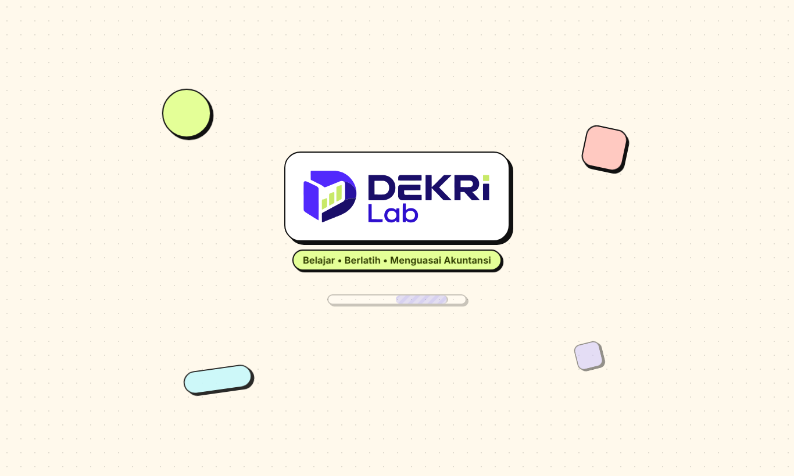

# DEKRi Lab

**Belajar • Berlatih • Menguasai Akuntansi**

Aplikasi latihan siklus akuntansi lengkap: jurnal umum, buku besar, neraca saldo, jurnal penyesuaian, laporan keuangan, dan penutupan, dengan penilaian otomatis, petunjuk bertahap, jalur belajar, dan mode ujian. Studi kasus: PT Sumber Cahaya Elektrindo (TA 2024).

- **Offline penuh.** Tanpa server, tanpa akun, tanpa telemetri. Progres tersimpan di perangkat Anda.
- **Windows (installer)** atau **satu berkas HTML** yang dibuka di Chrome/Edge.
- Penting: baca [DISCLAIMER.md](DISCLAIMER.md) (tidak berafiliasi dengan IAI, bukan nasihat profesional), [PRIVACY.md](PRIVACY.md), [SECURITY.md](SECURITY.md), dan [THIRD_PARTY_NOTICES.md](THIRD_PARTY_NOTICES.md). Lisensi MIT **hanya untuk kode sumber**; logo, kasus, kunci jawaban, dan materi tidak otomatis tercakup (lihat [docs/LICENSING.md](docs/LICENSING.md)). Konten disusun dengan bantuan AI (Claude) berlandaskan standar IAI, logo dibuat dengan ChatGPT: lihat `docs/CONTENT_SOURCES.md` dan `docs/ASSET_ATTRIBUTION.md`. Proyek ini tidak berafiliasi dengan IAI.
- Kode sumber berlisensi [MIT](LICENSE). Font Inter yang tertanam berlisensi SIL OFL 1.1 ([`src/assets/fonts/OFL.txt`](src/assets/fonts/OFL.txt)).




## Unduh dan pakai

1. Buka halaman **Releases** repositori ini dan unduh `DEKRi-Lab-Setup-<versi>.exe` lalu jalankan untuk memasang.
2. Opsional: cocokkan checksum dengan `SHA256SUMS.txt` pada rilis yang sama (`Get-FileHash "DEKRi-Lab-Setup-1.0.0.exe"` di PowerShell).
3. Ikuti penuntun pemasangan, lalu buka DEKRi Lab dari Desktop atau Start Menu. Windows SmartScreen dapat menampilkan peringatan karena EXE belum ditandatangani secara digital: pilih **More info**, lalu **Run anyway**.

Progres disimpan di `%APPDATA%\Latihan Siklus Akuntansi`, dengan cadangan otomatis ke `Dokumen\Latihan Siklus Akuntansi\Cadangan`. Nama folder ini sengaja dipertahankan agar progres dari versi lama tetap terbaca.

## Catatan penting

- Aplikasi ini untuk **belajar mandiri**. Kunci jawaban berada di dalam aplikasi dan hanya disembunyikan di antarmuka, jadi aplikasi ini bukan alat ujian yang aman dari kecurangan (lihat [`docs/AUDIT.md`](docs/AUDIT.md)).
- Teks materi ditulis oleh penulis dan belum diverifikasi terhadap teks PSAK resmi. Rujuk standar resmi untuk keperluan formal.
- Lihat [CONTRIBUTING.md](CONTRIBUTING.md) untuk berkontribusi, [SECURITY.md](SECURITY.md) untuk melaporkan masalah keamanan, dan [CHANGELOG.md](CHANGELOG.md) untuk riwayat versi.

---

## Pengembangan

Prasyarat: Node.js 20.19+ (disarankan 22).

```bash
npm ci
npm run dev           # pengembangan
npm run check         # typecheck + tes + Prettier
npm run build:single  # satu berkas HTML di dist-single/index.html
npm run desktop       # jalankan versi Electron dari hasil build:single
```

Rilis Windows dibangun otomatis oleh GitHub Actions saat tag versi didorong (`git tag v1.0.0 && git push origin v1.0.0`); lihat `.github/workflows/release.yml`.

## Tanpa Node.js

`dist-single/index.html` adalah satu file mandiri: klik dua kali untuk membuka di Chrome/Edge. Progres tersimpan per lokasi file; jangan memindahkan file setelah mulai (atau ekspor cadangan dulu). Buat ulang dengan `npm run build:single`.

## Buka di VS Code

1. Pasang Node.js 20+ (nodejs.org) dan VS Code.
2. Clone repositori ini (atau ekstrak zip), lalu di VS Code: File > Open Folder > pilih folder proyek.
3. Tekan `Ctrl+Shift+B` (Mac: `Cmd+Shift+B`) untuk menjalankan task "Mulai aplikasi" (npm install lalu dev server; peramban terbuka otomatis).
4. Tes: Terminal > Run Task > "Jalankan tes".

## Menjalankan

- `npm ci`
- `npm run dev` — pengembangan
- `npm test` — tes mesin akuntansi, penilaian, paritas dengan workbook
- `npm run build` — hasil di `dist/` (hosting statis; offline setelah kunjungan pertama)

## Struktur

- `data/*.json` — kasus dan kunci hasil ekstraksi workbook (`tools/extract_workbook.py`). `data/case.json` disunting manual untuk aplikasi; ekstraktor menulis `case.extracted.json` agar tidak menimpanya.
- `src/engine` — mesin murni (pembulatan Excel, buku besar, laporan hasil transpilasi rumus, penutup, pemeriksaan)
- `src/validation` — penilaian BELUM DIISI / BENAR / PERIKSA tanpa membocorkan kunci
- `src/store` — state pengguna, autosave, ekspor/impor cadangan JSON
- `src/ui` — 18 halaman

## Cadangan

- Pengaturan > Cadangan: ekspor/impor satu berkas JSON. Di aplikasi EXE, cadangan otomatis ke `Dokumen\Latihan Siklus Akuntansi\Cadangan` (lihat bawah).
- Mode ujian (menu Ujian): soal acak tanpa umpan balik, nilai di akhir; tidak mengubah progres belajar.
- Urungkan/Ulangi: Ctrl+Z / Ctrl+Shift+Z (maks. 100 langkah; 30 langkah terakhir tetap ada setelah halaman dimuat ulang).

## Tampilan

Gaya Google Workspace untuk desktop/laptop: token warna dan komponen global ada di `src/index.css`, ikon di `src/ui/components/Icon.tsx` (digambar sendiri, tanpa pustaka), kerangka (sidebar dan top bar) di `src/ui/App.tsx`. Semua aset lokal; tidak ada font atau ikon dari internet.

## Aplikasi Windows (installer)

- Bangun: klik dua kali `bangun-exe.bat` (butuh Node.js dan npm), atau `npm install && npm run typecheck && npm test && npm run dist:win`. Hasil yang dibagikan: `release/DEKRi-Lab-Setup-<versi>.exe` (installer NSIS: pilih folder pemasangan, pintasan Desktop dan Start Menu, uninstaller di Apps & Features). Folder `release/win-unpacked` hanyalah bahan baku pembuatan installer (berisi `DEKRi Lab.exe` yang tidak boleh dibagikan sendiri); `bangun-exe.bat` menghapusnya otomatis. Membangun installer harus dilakukan di Windows.
- Progres disimpan di `%APPDATA%\Latihan Siklus Akuntansi` (bukan di folder EXE). `appId` dan `productName` di `package.json`, serta konstanta `NAME` di `desktop/main.cjs`, jangan diubah setelah dipakai karena menentukan lokasi data (nama tampilan "DEKRi Lab" hanya untuk judul jendela, ikon, dan nama berkas EXE).
- `npm run desktop` menjalankan versi Electron dari hasil `build:single`. Uji persistensi di Linux: `xvfb-run -a node e2e/desktop.cjs`.
- Windows SmartScreen/antivirus dapat memberi peringatan karena EXE belum ditandatangani.

## Fitur belajar tambahan (roadmap)

- **Petunjuk bertahap** (Transaksi, Penyesuaian): 3 tingkat (kelompok akun, dasar perhitungan, sisi baris pertama). Tidak pernah memuat nominal jawaban (diuji untuk 147 + 28 soal). Setelah jawaban BENAR tampil "Mengapa jawaban ini benar?".
- **Tandai dan catatan** per soal; filter "Ditandai" di daftar transaksi.
- **Log percobaan dan tren** di Dashboard: aktivitas 14 hari, streak, akurasi mingguan.
- **Ujian**: batas waktu, sesi tersimpan saat halaman dimuat ulang (waktu tetap berjalan), tanda ragu, cakupan (tingkat, ditandai, topik lemah), soal koreksi dan deteksi kesalahan, pembahasan, riwayat skor.
- **Analisis**: kertas kerja 10 kolom, rasio keuangan, common size, arus kas, DuPont (turunan dari jawaban Anda).
- **Buku Pembantu**: piutang per pelanggan, utang per pemasok (dengan rekonsiliasi ke akun kontrol), kartu persediaan nilai rupiah.
- **Latihan Varian**: 6 pola soal berbenih; **Latihan Pajak**: PPN masukan/keluaran dan PPh 23 (akun tambahan di `src/data/ext.ts`, terpisah dari kasus utama). Soal ini tidak masuk akurasi Dashboard.
- **Soal berbagai industri** (halaman Latihan Varian): 103 soal jurnal dari 7 jenis usaha (jasa konsultasi, dagang busana, manufaktur furnitur, restoran, konstruksi, bimbingan belajar, ekspedisi), tiap industri dengan bagan akun sendiri dan penjelasan. Terpisah dari kasus utama; tidak memengaruhi laporan maupun akurasi Dashboard. Sumber data: `data/industri-packs.json`, dibuat ulang dengan `python3 -I tools/gen_industri.py data/industri-packs.json` (skrip juga mensimulasikan buku besar tiap industri sebagai pemeriksaan).
- **Paket PSAK 216** siap muat di `data/paket-psak/` (aset tetap: pertukaran, komponen, kompensasi asuransi, revaluasi).
- **Paket soal JSON**: muat soal tambahan tanpa build ulang (format: tombol "Unduh contoh format" di Latihan Varian). Paket boleh membawa `accounts` (bagan akun sendiri, opsional) dan `description`; lihat `data/industri-packs.json` sebagai contoh.
- **Ringkasan BAB 7-18** (tab di halaman Jalur Belajar; tautan lama `#/materi` dialihkan): ringkasan jurnal, rumus, jebakan; tertaut ke skenario.
- **EXE: cadangan otomatis** ke `Dokumen\Latihan Siklus Akuntansi\Cadangan` (terbaru + harian 7 hari), disimpan juga saat aplikasi ditutup; banner pemulihan bila progres kosong tetapi ada cadangan.

Data baru ada di `UserState` (`hints`, `flags`, `notes`, `log`, `exams`, `pajak`, `tables`) dan tetap `version: 1`: cadangan lama dibaca dengan nilai awal kosong (tes: `tests/engine/migrate-roadmap.test.ts`).

## Jalur Belajar dan umpan balik

- **Jalur Belajar** (`#/belajar`): 13 materi berurutan, masing-masing berisi tujuan, konsep, teori, contoh, penyelesaian, latihan, pembahasan, dan evaluasi (kuis). Status Belum mulai / Sedang dipelajari / Selesai, persentase, prasyarat, dan rekomendasi materi berikutnya dihitung dari pekerjaan nyata (jurnal yang benar dan nilai kuis). Ambang kuis dan target latihan adalah pilihan pedagogis penulis, bukan standar resmi.
- **Umpan balik per jenis kesalahan**: setelah Periksa, aplikasi menjelaskan jenis kesalahan (akun salah, sisi debit/kredit terbalik, nominal salah, dsb.).
- **Skor komponen** (Dashboard): per jurnal, 3 komponen per akun kunci (akun, sisi, nominal) dikurangi 1 per akun berlebih. Ini metrik tambahan; status BENAR/PERIKSA dan akurasi tidak berubah. Di halaman Penutup tiap baris punya dua status: "konsisten dengan buku Anda" dan "sesuai kunci kasus".
- **Klasifikasi arus kas** pada analisis transaksi adalah latihan tanpa penilaian: laporan arus kas dibangun dari kunci kasus, bukan dari isian pengguna.
- **Toleransi nominal** per soal: bawaan Rp1 (setara workbook); Latihan Varian dari generator memakai Rp0.
- Teks materi ditulis penulis dan belum diverifikasi terhadap teks PSAK resmi.

## Analisis keuangan

Halaman **Analisis** memiliki tab: Kertas kerja, Dasbor analisis, Rasio, Common size, Arus kas, dan DuPont. Analisis tren dan perbandingan antarperiode tidak ada karena kasus hanya memuat satu periode. Semua angka diturunkan dari jurnal pengguna.

- 16 rasio (likuiditas, solvabilitas, profitabilitas, aktivitas), masing-masing dengan rumus, data sumber, hasil, interpretasi, dan keterbatasan. Tidak ada label sehat/tidak sehat. Saldo akhir dipakai, kecuali perputaran piutang dan persediaan (rata-rata awal dan akhir).
- Common size laba rugi dan neraca per akun.
- Arus kas per aktivitas dengan pemeriksaan konsistensi kas akhir terhadap neraca; DuPont tiga komponen.

## Fitur aplikasi desktop

**Kalkulator** bawaan (tombol di header atau `Alt+C`): ekspresi `+ - * /`, tanda kurung, dan `%`; format Indonesia (koma = desimal, titik ribuan terisi otomatis saat mengetik); jendela melayang yang bisa digeser; riwayat 10 hitungan selama aplikasi terbuka; hasil bisa disalin atau dimasukkan ke kolom nominal yang terakhir diklik (dibulatkan ke rupiah). Penguraian ekspresi dilakukan sendiri tanpa `eval`.

Pengaturan memuat ukuran tampilan (90–150%), pintasan keyboard (juga tombol `?`), dan Tentang (versi). Panduan awal tampil sekali pada pemakaian pertama. Di aplikasi EXE ada tombol **Simpan PDF** (Electron `printToPDF`); di peramban gunakan **Cetak**.

Keamanan Electron: contextIsolation, sandbox, tanpa nodeIntegration, jembatan IPC sempit (7 metode) dengan validasi pengirim, semua permintaan izin perangkat ditolak, `window.open` dan webview diblokir. Lihat `docs/AUDIT.md`. Riwayat temuan audit workbook diarsipkan di `docs/RIWAYAT-TEMUAN-WORKBOOK.md`.

## Tes

- `tests/sim/` mensimulasikan pengerjaan SEMUA soal dengan jawaban kunci (store dan UI) dan memeriksa laporan, ujian, Jalur Belajar, cadangan, serta generator varian; paling lama (±1 menit), bisa dijalankan sendiri: `npx vitest run tests/sim --no-file-parallelism`.
- `npm test` menjalankan: mesin dan penilaian, kesetaraan dengan Excel (jawaban kunci dan 2.304 jawaban salah), alur UI (jsdom), dan logika cadangan.
- Memperbarui fixture Excel (butuh LibreOffice dan workbook asli): `python3 tools/fill_workbook_with_key.py <xlsx>` dan `python3 tools/mutated_parity.py <xlsx>`.

## Kualitas kode

- `npm run check` = `tsc --noEmit` + semua tes + pemeriksaan Prettier. `npm run format` merapikan kode.
- ESLint belum dipasang: typescript-eslint belum mendukung TypeScript 7 yang dipakai proyek ini. TypeScript mode ketat dengan `noUnusedLocals` menggantikan sebagian perannya.
- `npm run e2e` menjalankan tes browser Chromium (Playwright). Prasyarat: `npm run build`, lalu `npm run preview` di terminal lain, dan pustaka `playwright` tersedia (`npm i -g playwright`, lalu `NODE_PATH=$(npm root -g) npm run e2e`). Variabel opsional: `WORKBOOK_XLSX` (jalur workbook asli) dan `FULL_BACKUP` (cadangan JSON berisi semua jawaban, untuk mengukur penelusuran angka terberat).

## Catatan

- Ekspor JSON di halaman Pengaturan secara berkala (data peramban bisa terhapus).
- Penilaian memakai toleransi Rp1 seperti rumus workbook.

## Perubahan keandalan (lanjutan audit)

- **Penutupan sadar tanda**: baris `3-3000` menerima laba (debit Ikhtisar) maupun rugi (kredit Ikhtisar); Neraca Saldo setelah Penutupan tetap seimbang. Tes: `tests/engine/closing-loss.test.ts`.
- **Validasi impor/muat state** (`src/store/state.ts`): setiap baris jurnal dicek (nominal berhingga 0 s.d. 10 triliun, kode akun dikenal, kunci `__proto__` ditolak, batas jumlah). Isian tidak valid dibuang dan jumlahnya ditampilkan sebelum pemulihan. Berkas cadangan maks. 25 MB. Tes: `tests/engine/sanitize.test.ts`.
- **Salinan pengaman**: progres disalin otomatis sebelum impor cadangan atau reset; dapat dikembalikan dari Pengaturan > Cadangan.
- **Autosave**: ditulis segera saat jendela disembunyikan/ditutup (termasuk sebelum EXE menutup), dicoba ulang tiap 5 detik bila gagal, dan dijeda bila tab lain menyimpan data (banner pilihan "Muat data terbaru" / "Pakai data di tab ini").
- **Arus kas**: UI menyatakan bahwa pengelompokan aktivitas mengikuti kunci kasus.
- **Golden test konten**: tiap jurnal kunci transaksi/penyesuaian seimbang dan memakai akun yang ada (`tests/engine/content-integrity.test.ts`).
