# DEKRi Lab

**Belajar • Berlatih • Menguasai Akuntansi**

[](https://github.com/Muhammad-Ridhwan-Hanafi/DEKRi-Lab/actions/workflows/ci.yml) [](https://github.com/Muhammad-Ridhwan-Hanafi/DEKRi-Lab/releases) [](LICENSE)  

DEKRi Lab adalah aplikasi desktop untuk berlatih akuntansi dari awal sampai akhir: mencatat jurnal, buku besar, penyesuaian, laporan keuangan, sampai penutupan buku. Jawaban Anda diperiksa otomatis, ada petunjuk bertahap kalau Anda buntu, dan setiap kunci jawaban disertai penjelasan langkah demi langkah. Contoh kasusnya perusahaan rekaan, PT Sumber Cahaya Elektrindo (tahun buku 2024).

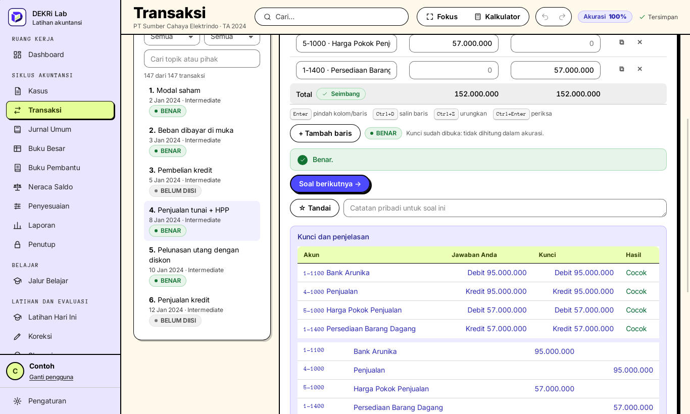

**Isi halaman ini:** [Ringkasan](#ringkasan) · [Versi 2 dibanding versi 1](#versi-2-dibanding-versi-1) · [Untuk siapa dan apa isinya](#untuk-siapa-dan-apa-isinya) · [Fitur](#fitur) · [Kebutuhan sistem](#kebutuhan-sistem) · [Cara memasang](#cara-memasang-windows) · [Tampilan](#tampilan) · [Pintasan keyboard](#pintasan-keyboard) · [Progres dan cadangan](#progres-dan-cadangan) · [Pertanyaan umum](#pertanyaan-umum) · [Saran dan pertanyaan](#saran-dan-pertanyaan) · [Penting dibaca](#penting-dibaca) · [Lisensi](#lisensi) · [Untuk pengembang](#untuk-pengembang)

## Ringkasan

- **Tidak butuh internet.** Setelah terpasang, semuanya berjalan di komputer Anda.
- **Tidak ada akun, tidak ada pengiriman data.** Progres belajar hanya tersimpan di komputer Anda.
- **Ringan.** Satu berkas program kecil yang ditulis dengan Rust, tanpa Node.js dan tanpa peramban yang ikut dibundel.
- **Gratis dan terbuka.** Kode sumber berlisensi MIT.
- **Windows 10 dan 11 (64-bit).** Pemasang dan ZIP tanpa pemasangan tersedia di halaman **Releases**.

## Versi 2 dibanding versi 1

Versi 2.0.0 menulis ulang seluruh aplikasi, tetapi isi pelajarannya tetap sama: kasus, soal, kunci jawaban, penjelasan, dan hasil penilaian tidak berubah. Yang berubah adalah mesin di baliknya, tampilan, dan sejumlah fitur belajar baru.

| | Versi 1 (1.0.x) | Versi 2 (2.0.0) |
| --- | --- | --- |
| Dibangun dengan | Electron, React, dan TypeScript | Rust dengan [Dioxus](https://dioxuslabs.com) |
| Yang ikut dibawa | Node.js dan Chromium di dalam pemasang | Satu berkas program (sekitar 9 MB pada build rilis Linux yang diukur); tampilan memakai Microsoft Edge WebView2 bawaan Windows |
| Memori saat diam (Task Manager) | 209,4 MB untuk 4 proses | 6,8 MB untuk proses aplikasi (lihat [catatan](#pemakaian-memori)) |
| Cara menjalankan | Pemasang Windows atau berkas `DEKRi-Lab.html` | Pemasang Windows atau ZIP tanpa pemasangan (versi HTML dihentikan) |
| Penyimpanan progres | Penyimpanan peramban bawaan Electron (IndexedDB) | Berkas JSON per pengguna di folder yang sama |
| Cadangan otomatis | Ada | Ada, dengan format dan folder yang sama sehingga cadangan lama tetap terbaca |
| Penilaian dan laporan | Dicocokkan dengan workbook Excel sumber | Hasilnya sama; 298 sel laporan dan lebih dari 2.000 jawaban uji dicocokkan dengan workbook dan versi 1 |
| Tampilan | Lila, hijau limau, krem, garis hitam tebal | Identitas yang sama, dimatangkan: sistem desain baru, tema Ikuti sistem, Terang, atau Gelap, dan hierarki yang lebih jelas |
| Kalkulator | Melayang, titik ribuan otomatis | Sama; juga menerima `x` sebagai tanda kali dan menjaga kursor saat Anda mengedit di tengah rumus panjang |
| Rilis resmi | Windows | Windows 64-bit (kode sumber juga bisa dibangun di Linux dan macOS) |

**Fitur yang baru di versi 2**

- **Latihan Hari Ini**: antrean maksimal 10 soal yang dipilih dari ulangan yang jatuh tempo, topik terlemah, lalu transaksi berikutnya, lengkap dengan petunjuk dan kunci.
- **Peta konsep** di Dashboard: satu kotak per jenis transaksi, berwarna menurut hasil Anda.
- **Bagaimana-jika** di Laporan: ubah nominal satu jurnal dan lihat pos laporan mana yang bergeser.
- **Dampak jurnal ke laporan** di Transaksi: jurnal, akun, lalu pos laporan yang terpengaruh.
- **Penelusuran asal angka**: klik angka di Laporan untuk melihat dari jurnal mana angka itu berasal.
- **Pemeriksaan silang** dengan dugaan penyebab bila ada selisih.
- **Tempel dari Excel atau Google Sheets** langsung ke tabel jurnal (kolom Akun, Debit, Kredit).
- **Riwayat jawaban** per soal, **diagnosis kesalahan** tanpa membuka kunci, dan perbandingan jawaban Anda dengan kunci.
- **Mode Fokus** (`Alt+F`): menu disembunyikan dan tampilan diperbesar.
- **Pesan yang jelas untuk "Peristiwa ini tidak perlu jurnal"**: kalau Anda mencentangnya pada peristiwa yang sebenarnya memerlukan jurnal, aplikasi memberi tahu dan tidak diam saja.
- **Kasus > Profil** dirancang ulang menjadi kartu identitas perusahaan, petunjuk bernomor, kartu informasi, dan tabel aging piutang yang rapi.
- **Audit konsistensi data** dan tombol **Laporkan soal ini** di Pengaturan > Tentang.
- **Pemulihan otomatis** dari cadangan terbaru bila progres kosong tetapi cadangan ada.

**Yang belum ada di versi 2**

- Versi HTML mandiri (`DEKRi-Lab.html`) tidak dilanjutkan.
- Tombol **Cetak / simpan PDF** membuka laporan di peramban untuk dicetak (pilih Simpan sebagai PDF); aplikasi belum membuat berkas PDF sendiri.
- Progres yang tersimpan di penyimpanan peramban versi 1 tidak ikut pindah otomatis. Cara memindahkannya ada di [Pindah dari versi 1](#pindah-dari-versi-1).
- Belum ada ekspor ke Excel (juga tidak ada di versi 1).

Rincian lengkap tiap perubahan ada di [CHANGELOG.md](CHANGELOG.md).

### Pemakaian memori

Pengamatan di Task Manager Windows saat aplikasi dibuka dan dibiarkan diam:

| Versi 1 (Electron): 4 proses, total 209,4 MB | Versi 2 (Rust): `dekri-lab.exe`, 6,8 MB |
| --- | --- |
| 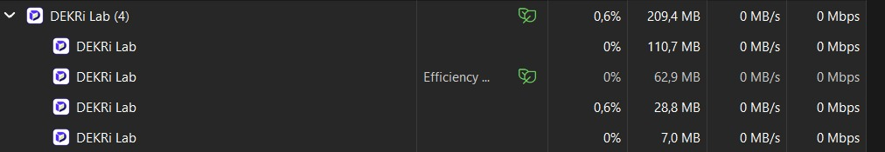 | 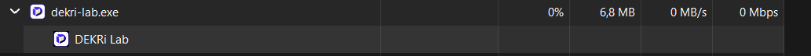 |

Catatan agar perbandingannya adil: angka 6,8 MB adalah proses aplikasi itu sendiri. Tampilannya digambar oleh Microsoft Edge WebView2 milik Windows, yang berjalan sebagai proses terpisah (`msedgewebview2.exe`) dan bisa dipakai bersama aplikasi lain, jadi tidak termasuk dalam angka tersebut. Ini pengamatan satu kali pada satu komputer, bukan tolok ukur baku; angkanya bisa berbeda di komputer dan versi Windows lain.

## Untuk siapa dan apa isinya

Untuk pelajar, mahasiswa, dan siapa pun yang belajar akuntansi dan ingin berlatih sendiri di komputer atau laptop.

| Bagian | Isi |
| --- | --- |
| Jalur Belajar | 13 materi berurutan (dari dasar-dasar akuntansi sampai analisis laporan keuangan), masing-masing dengan tujuan, konsep, contoh, latihan, dan kuis; ditambah Ringkasan BAB 7 sampai 18 |
| Kasus utama | PT Sumber Cahaya Elektrindo: 147 transaksi, 28 penyesuaian, bagan akun 84 akun, saldo awal, dan penutupan buku |
| Skenario | 26 skenario penalaran, ditambah soal arus kas (9 soal) di halaman yang sama |
| Koreksi | 12 kasus koreksi dan 12 latihan mendeteksi jenis kesalahan |
| Latihan Varian | Soal berpola yang dibuat dari benih sehingga bisa diulang dengan angka berbeda |
| Latihan Pajak | PPN dan PPh 23 |
| Kasus industri | 103 soal jurnal dari 7 jenis usaha: jasa konsultasi, dagang busana, manufaktur furnitur, restoran, konstruksi, bimbingan belajar, dan ekspedisi |
| Ujian | Soal acak tanpa umpan balik dengan batas waktu opsional; nilai dan pembahasan muncul di akhir |

## Fitur

- **Pemeriksaan otomatis.** Tekan **Periksa** pada jurnal Anda. Hasilnya Benar, Periksa, atau Belum diisi, dengan penjelasan jenis kesalahan (akun salah, sisi debit dan kredit terbalik, nominal salah) tanpa membocorkan jawaban. Urutan baris tidak memengaruhi penilaian dan baris dengan akun yang sama boleh digabung.
- **Petunjuk bertahap.** Makin lama makin spesifik, dari kelompok akun sampai dasar perhitungan, tanpa pernah menampilkan nominal jawaban.
- **Kunci dan penjelasan.** Setelah menyerah atau selesai, buka kunci: ada perbandingan dengan jawaban Anda, penjelasan singkat (Intinya, Mengapa dicatat begini, Ingat), dan jurnal kuncinya.
- **Buku dan laporan dari jurnal Anda.** Jurnal Umum, Buku Besar (saldo berjalan, filter periode), Buku Pembantu (piutang, utang, persediaan), Neraca Saldo sebelum dan sesudah penyesuaian, serta Laporan: laba rugi, perubahan ekuitas, posisi keuangan, dan arus kas, termasuk tampilan menurut PSAK 118 dan PSAK 207.
- **Dashboard.** Kemajuan belajar, akurasi, topik yang perlu diulas, aktivitas 14 hari, dan langkah berikutnya.
- **Kalkulator melayang** yang bisa digeser (`Alt+C`): `+ - x / ( )` dan `%`, format Indonesia (titik ribuan terisi otomatis, koma desimal), riwayat 10 hitungan, hasil bisa dimasukkan ke kolom nominal.
- **Pencarian cepat** (`Ctrl+K`), **urungkan dan ulangi** (`Ctrl+Z`, `Ctrl+Y`), dan **mode Fokus** (`Alt+F`).
- **Tema** Ikuti sistem, Terang, atau Gelap, serta ukuran tampilan 90% sampai 150%.
- **Banyak pengguna di satu komputer.** Masuk dengan nama (bukan akun, tanpa kata sandi); progres dipisah per nama.
- **Cadangan otomatis** dan ekspor atau impor cadangan manual.

## Kebutuhan sistem

- Windows 10 atau 11, 64-bit.
- **Microsoft Edge WebView2 Runtime.** Sudah ada di Windows 11 dan di sebagian besar Windows 10 yang diperbarui. Kalau aplikasi tidak mau terbuka atau jendelanya kosong, pasang WebView2 Runtime dari situs Microsoft, lalu coba lagi.
- Layar komputer atau laptop dengan resolusi minimal 1024 x 640 (ukuran jendela terkecil yang diizinkan aplikasi).
- Ruang disk beberapa megabita untuk program, ditambah sedikit untuk progres dan cadangan Anda.

## Cara memasang (Windows)

Buka halaman **Releases** di repositori ini (di sisi kanan halaman GitHub), lalu pilih salah satu:

**A. Pemasang (disarankan)**

1. Unduh berkas yang namanya diawali `DEKRi-Lab-Setup` dan berakhiran `.exe`.
2. Klik dua kali, lalu ikuti langkahnya: pilih folder tujuan (atau biarkan bawaan), klik **Install**, lalu **Finish**. Pemasangan per pengguna, tidak perlu hak administrator.
3. Buka dari ikon di Desktop atau menu Start.

**B. Tanpa memasang**

1. Unduh `DEKRi-Lab-windows-x64.zip`, lalu ekstrak ke folder mana pun.
2. Jalankan `dekri-lab.exe`.

**Kalau muncul peringatan biru "Windows protected your PC":** itu normal, karena pemasang ini belum memiliki tanda tangan digital berbayar. Unduh hanya dari halaman Releases repositori ini. Lalu klik **More info**, kemudian **Run anyway**.

### Memeriksa keaslian unduhan (opsional)

Setiap rilis menyertakan `SHA256SUMS.txt`. Buka PowerShell di folder unduhan, lalu jalankan (sesuaikan nama berkas dengan versi yang Anda unduh):

```powershell
Get-FileHash .\DEKRi-Lab-Setup-2.0.0.exe -Algorithm SHA256
```

Bandingkan hasilnya dengan baris berkas yang sama di `SHA256SUMS.txt` (huruf besar atau kecil tidak berpengaruh). Kalau berbeda, jangan dipasang; unduh ulang dari halaman Releases. Checksum hanya membuktikan berkas tidak berubah sejak dipublikasikan, bukan siapa penerbitnya.

### Memperbarui

Ekspor cadangan dulu lewat **Pengaturan > Cadangan > Ekspor cadangan**. Lalu unduh pemasang versi baru dan jalankan; progres Anda tersimpan di folder data pengguna Windows, bukan di folder program, jadi tidak tertimpa. Untuk versi ZIP, ekstrak versi baru ke folder yang sama atau folder lain.

### Mencopot

Buka **Pengaturan Windows > Aplikasi**, pilih **DEKRi Lab**, lalu **Uninstall**. Progres Anda sengaja tidak ikut terhapus, supaya aman kalau Anda memasang ulang. Untuk menghapus semuanya, hapus dua folder bernama `Latihan Siklus Akuntansi`: satu di `%APPDATA%` dan satu di **Dokumen** (isinya cadangan otomatis). Versi ZIP cukup dihapus folder programnya.

## Tampilan

Semua tangkapan layar memakai data contoh dan perusahaan fiktif.

| | |
| --- | --- |
| 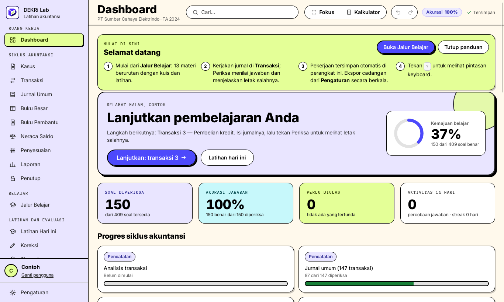<br>**Dashboard**: kemajuan, akurasi, dan langkah berikutnya | 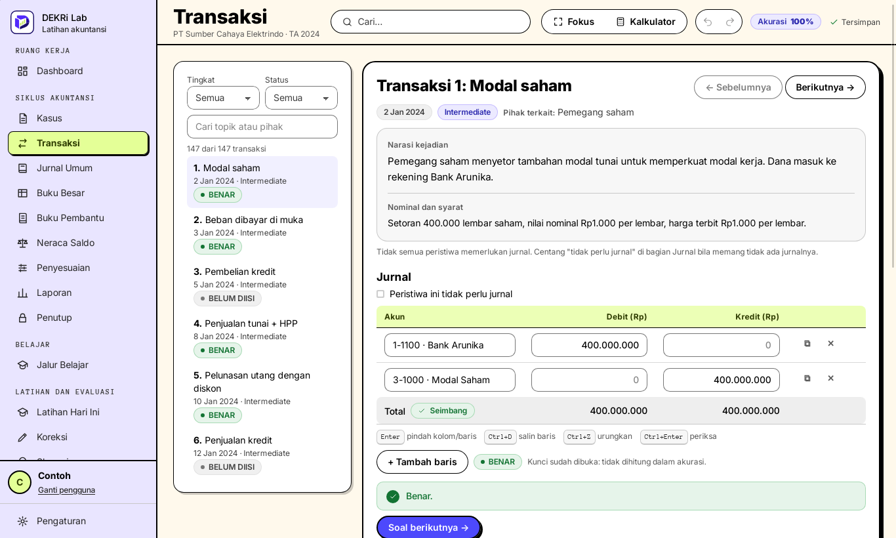<br>**Transaksi**: isi jurnal, tekan Periksa, dan lihat hasilnya |
| <br>**Kunci dan penjelasan**: perbandingan dengan jawaban Anda | 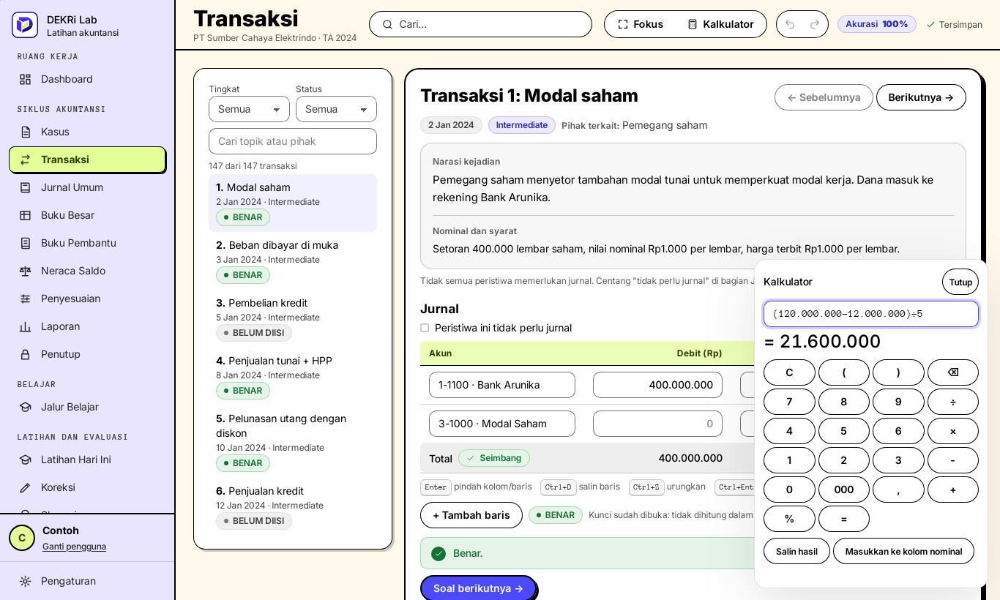<br>**Kalkulator** yang bisa digeser, dengan titik ribuan otomatis |
| 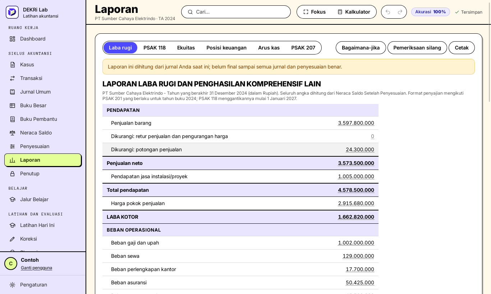<br>**Laporan keuangan** dihitung dari jurnal Anda | 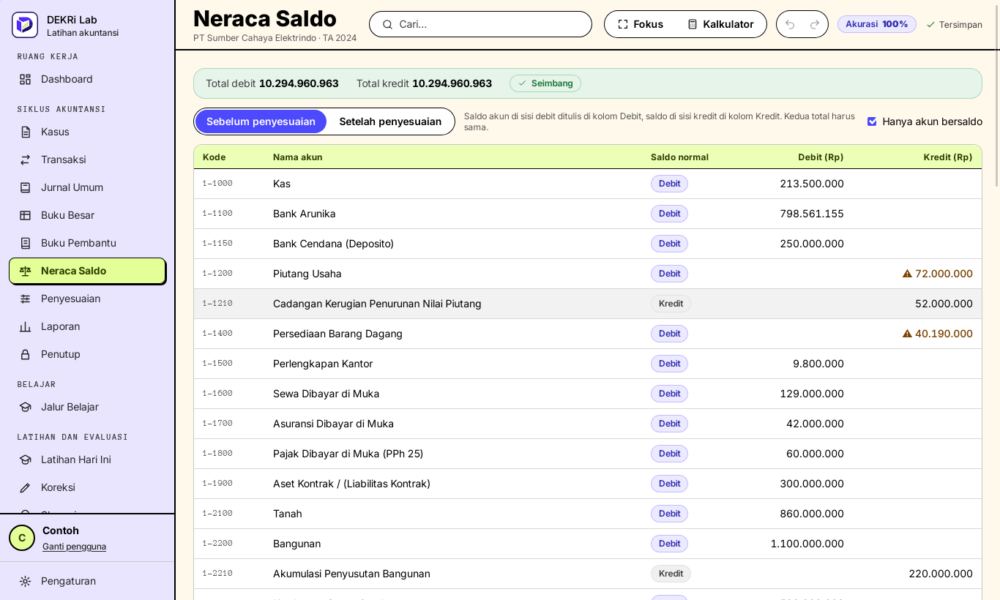<br>**Neraca saldo** sebelum dan sesudah penyesuaian |
| 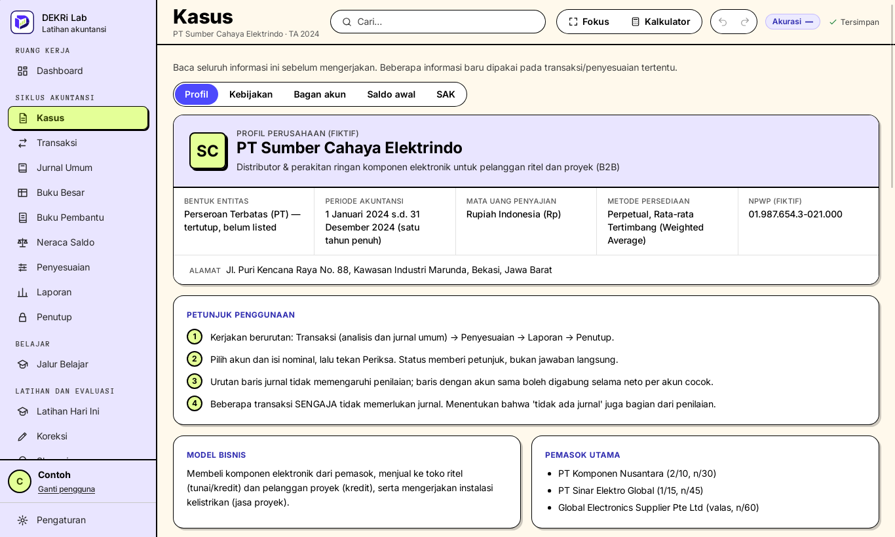<br>**Kasus > Profil**: identitas perusahaan, petunjuk, dan informasi | 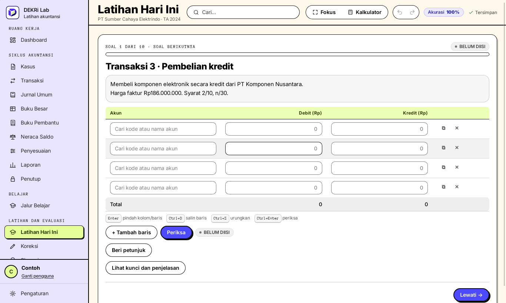<br>**Latihan Hari Ini**: antrean soal yang dipilihkan |
| 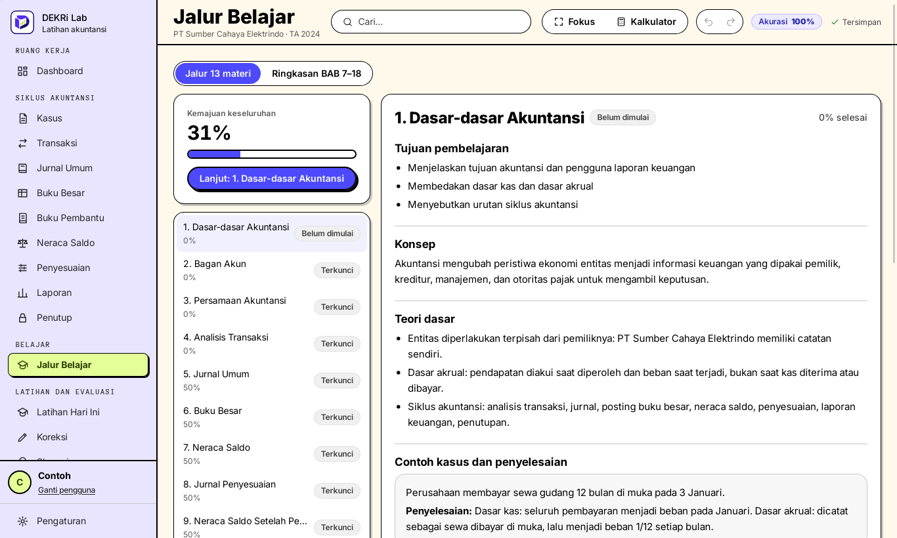<br>**Jalur Belajar**: 13 materi dengan kuis | 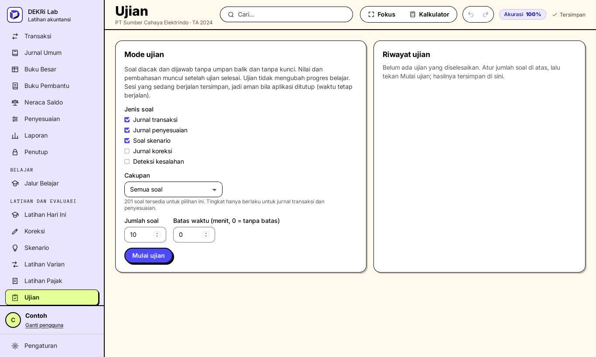<br>**Ujian**: soal acak dengan nilai di akhir |
| 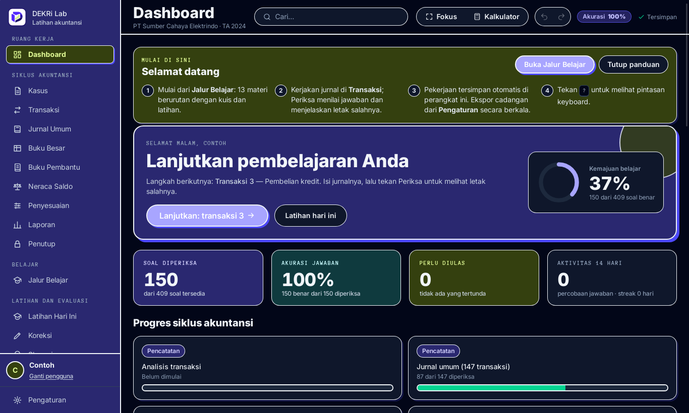<br>**Tema gelap** | 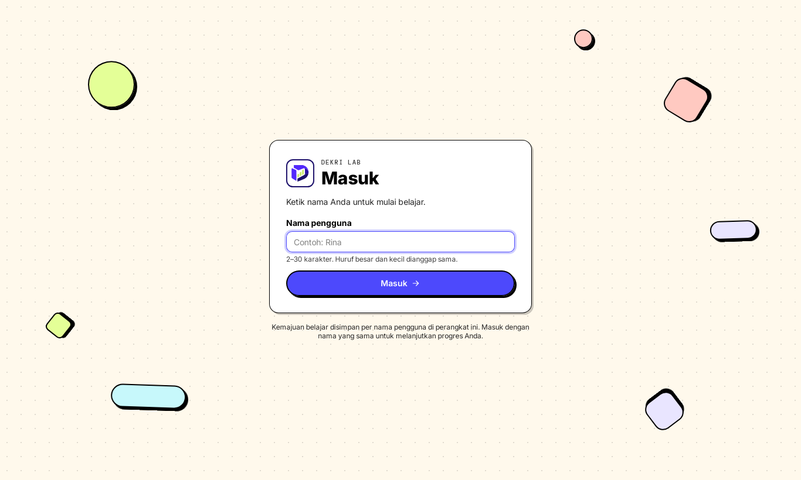<br>**Masuk dengan nama** (tanpa kata sandi) |

## Pintasan keyboard

| Pintasan | Fungsi |
| --- | --- |
| `Ctrl+K` atau `/` | Buka pencarian |
| `Ctrl+Z` | Urungkan |
| `Ctrl+Shift+Z` atau `Ctrl+Y` | Ulangi |
| `Alt+C` | Buka atau tutup kalkulator (geser dengan mouse atau `Alt` + tombol panah) |
| `Alt+F` | Mode Fokus: menyembunyikan menu dan memperbesar tampilan |
| `Ctrl+P` | Cetak halaman (atau Simpan PDF dari tombol di halaman laporan) |
| `?` | Tampilkan daftar pintasan |
| `Esc` | Tutup dialog |
| `Enter` | Pindah kolom atau baris pada tabel jurnal |
| `Ctrl+D` | Salin baris jurnal |
| `Ctrl+Enter` | Periksa jawaban |

## Progres dan cadangan

- Progres tersimpan otomatis di `%APPDATA%\Latihan Siklus Akuntansi`, terpisah untuk tiap nama pengguna yang Anda ketik saat masuk (nama itu bukan akun dan tidak diverifikasi; huruf besar dan kecil dianggap sama).
- Cadangan otomatis ditulis ke **Dokumen > Latihan Siklus Akuntansi > Cadangan** (7 berkas harian terakhir per pengguna). Nama folder itu sengaja dipertahankan dari versi 1 supaya cadangan lama tetap terbaca.
- Anda juga bisa mengekspor dan mengimpor cadangan sendiri lewat **Pengaturan**. Sebelum impor atau reset, progres Anda disalin dulu sebagai pengaman.
- **Hapus semua progres** di Pengaturan harus dikonfirmasi dengan mengetik `RESET`, dan menyimpan cadangan terakhir lebih dulu.
- Cadangan tidak dienkripsi. Jangan membagikannya ke orang lain kalau tidak ingin jawaban Anda terlihat.

### Pindah dari versi 1

Versi 2 memakai nama folder dan format cadangan yang sama dengan versi 1, tetapi tidak membaca penyimpanan peramban (IndexedDB) milik versi 1. Ada dua cara memindahkan progres:

1. **Otomatis lewat cadangan.** Versi 1 sudah menulis cadangan otomatis ke **Dokumen > Latihan Siklus Akuntansi > Cadangan**. Di versi 2, masuk dengan **nama yang sama** seperti di versi 1. Kalau belum ada progres di versi 2, aplikasi memulihkan dari cadangan terbaru dan menampilkan pemberitahuan.
2. **Manual.** Di versi 1, ekspor cadangan lewat **Pengaturan > Cadangan**. Di versi 2, impor berkas itu lewat **Pengaturan > Impor cadangan**.

Pengguna versi HTML memakai cara 2.

## Pertanyaan umum

**Aplikasi tidak terbuka atau jendelanya kosong.**
Pastikan WebView2 Runtime terpasang (lihat [Kebutuhan sistem](#kebutuhan-sistem)).

**Progres saya tidak muncul setelah masuk.**
Progres dipisah per nama pengguna dan huruf besar atau kecil tidak dibedakan, tetapi ejaan harus sama. Coba nama yang Anda pakai sebelumnya, atau pulihkan lewat **Pengaturan > Cadangan**.

**Bisa dipakai di dua komputer?**
Bisa, tetapi progres tidak tersinkron otomatis. Ekspor cadangan di satu komputer, lalu impor di komputer lain lewat **Pengaturan**.

**Bagaimana menyimpan laporan sebagai PDF?**
Tekan **Cetak / simpan PDF** di halaman Laporan. Laporan terbuka di peramban; tekan `Ctrl+P` lalu pilih simpan sebagai PDF.

**Bisa diekspor ke Excel?**
Belum.

**Apakah data saya dikirim ke suatu tempat?**
Tidak. Aplikasi berjalan offline dan tidak punya akun, pelacakan, atau server di internet. Rinciannya ada di [Privasi](PRIVACY.md).

**Bisa di macOS atau Linux?**
Kode sumbernya bisa dibangun di sana (lihat [docs/BUILD.md](docs/BUILD.md)), tetapi rilis resmi dan pengujian saat ini hanya untuk Windows 10 dan 11 64-bit.

**Apakah ini cocok untuk ujian sungguhan?**
Tidak. Kunci jawaban ada di dalam aplikasi, sehingga aplikasi ini alat belajar, bukan alat ujian yang aman dari kecurangan.

## Saran dan pertanyaan

- Soal atau kunci jawaban yang tampak keliru: [laporkan di sini](../../issues/new?template=soal_salah.yml), atau salin tautannya dari Pengaturan > Tentang.
- Ada yang tidak berfungsi: [laporan bug](../../issues/new?template=bug_report.yml).
- Usul fitur atau perbaikan: [kirim saran](../../issues/new?template=saran.yml).
- Masalah keamanan: ikuti petunjuk di [Keamanan](SECURITY.md), jangan membuka issue publik berisi detail teknis.

## Penting dibaca

- Ini alat belajar mandiri, **bukan** pengganti standar akuntansi resmi, dan **bukan** nasihat akuntansi, pajak, atau hukum.
- Proyek ini **tidak memiliki afiliasi apa pun** dengan lembaga atau pihak mana pun.
- Semua perusahaan, bank, dan nama dalam soal fiktif. Kesamaan dengan pihak nyata adalah ketidaksengajaan.
- Soal disusun agar sesuai dengan standar akuntansi (PSAK), tetapi masih mungkin ada kesalahan. Kalau Anda menemukannya, laporkan lewat [Issues di GitHub](../../issues/new?template=soal_salah.yml).
- Pemasang Windows belum ditandatangani secara digital, jadi Windows dapat menampilkan peringatan.

Dokumen lain: [Penafian](DISCLAIMER.md) · [Privasi](PRIVACY.md) · [Keamanan](SECURITY.md) · [Perubahan](CHANGELOG.md) · [Cara berkontribusi](CONTRIBUTING.md) · [Asal konten](docs/CONTENT_SOURCES.md) · [Asal logo dan aset](docs/ASSET_ATTRIBUTION.md)

## Lisensi

Hanya **kode sumber** yang berlisensi [MIT](LICENSE). Logo, kasus, kunci jawaban, dan materi belajar tidak otomatis termasuk lisensi itu (lihat [cakupan lisensi](docs/LICENSING.md)). Font Inter memakai lisensi SIL OFL 1.1, dan pustaka pihak ketiga memakai lisensinya masing-masing ([daftar](THIRD_PARTY_NOTICES.md)).

## Untuk pengembang

Aplikasi ini adalah workspace Rust: `crates/dekri-core` (mesin akuntansi, penilaian, laporan; tanpa UI) dan `crates/dekri-ui` (antarmuka Dioxus di WebView sistem). Data kasus ada di `data/` dan dibenamkan ke dalam program.

```bash
cargo run -p dekri-ui --release     # jalankan
cargo test --workspace               # semua tes
cargo fmt --all -- --check           # format
cargo clippy --workspace --all-targets -- -D warnings
```

- Cara membangun dari kode sumber, membuat pemasang, dan merilis: [docs/BUILD.md](docs/BUILD.md)
- Struktur, prinsip, dan variabel pengembangan: [docs/DEVELOPMENT.md](docs/DEVELOPMENT.md)
- Apa saja yang diuji dan batasannya: [docs/TESTING.md](docs/TESTING.md)
- Bahasa visual dan komponen antarmuka: [docs/DESIGN-SYSTEM.md](docs/DESIGN-SYSTEM.md)
- Rancangan keamanan: [docs/SECURITY_ARCHITECTURE.md](docs/SECURITY_ARCHITECTURE.md)
- Pengaturan repositori GitHub (teks About, topics, proteksi cabang): [docs/GITHUB_SETUP.md](docs/GITHUB_SETUP.md)
