# DEKRi Lab

**Belajar • Berlatih • Menguasai Akuntansi**

DEKRi Lab adalah aplikasi untuk berlatih akuntansi dari awal sampai akhir: mencatat jurnal, buku besar, penyesuaian, laporan keuangan, sampai penutupan buku. Jawaban Anda diperiksa otomatis, dan ada petunjuk bertahap kalau Anda buntu. Contoh kasusnya perusahaan rekaan, PT Sumber Cahaya Elektrindo.

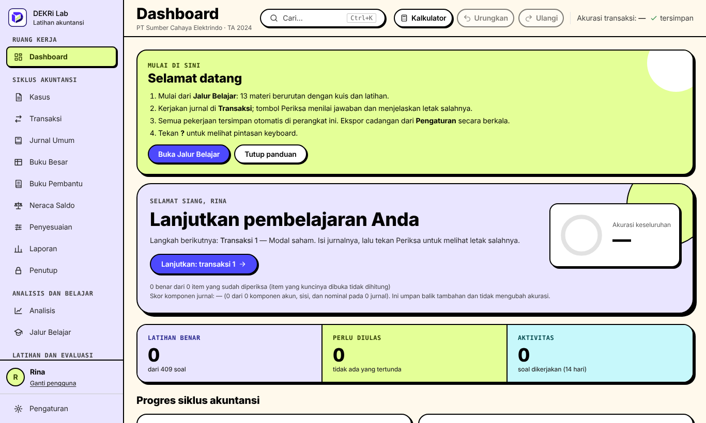

## Yang perlu Anda tahu

- **Tidak butuh internet.** Setelah terpasang, semuanya jalan di komputer Anda.
- **Tidak ada akun, tidak ada pengiriman data.** Progres belajar hanya tersimpan di komputer Anda.
- **Gratis dan terbuka.**

## Cara memakai (pilih salah satu)

### Cara 1 (paling mudah): tanpa memasang apa pun

1. Buka halaman **Releases** di repositori ini (di sisi kanan halaman GitHub), lalu unduh berkas `DEKRi-Lab.html`.
2. Klik dua kali berkas itu. Ia terbuka di Chrome atau Edge, dan Anda bisa langsung berlatih.

Simpan berkas ini di satu tempat tetap dan jangan dipindahkan, karena progres tersimpan berdasarkan lokasi berkas. Kalau perlu pindah, buka **Pengaturan > Cadangan** dan ekspor dulu.

### Cara 2: Pasang di Windows

Pilih cara ini kalau Anda ingin cadangan otomatis dan tombol Simpan PDF.

1. Di halaman **Releases**, unduh berkas yang namanya diawali `DEKRi-Lab-Setup` dan berakhiran `.exe`.
2. Klik dua kali, lalu ikuti petunjuk di layar. Anda bisa memilih folder tujuan pemasangan, lalu klik **Next** dan **Install** sampai selesai.
3. Buka **DEKRi Lab** dari ikon di Desktop atau menu Start.

**Kalau muncul peringatan biru "Windows protected your PC":** itu normal, karena pemasang ini belum memiliki tanda tangan digital berbayar. Unduh hanya dari halaman Releases repositori ini. Lalu:

1. Klik **More info**.
2. Klik **Run anyway**.

**Kalau pemasangan gagal:** pakai Cara 1. Hasilnya sama untuk berlatih.

## Tampilan

Semua tangkapan layar memakai data contoh dan perusahaan fiktif.

|                                                                                                                                   |                                                                                                                                   |
| --------------------------------------------------------------------------------------------------------------------------------- | --------------------------------------------------------------------------------------------------------------------------------- |
| 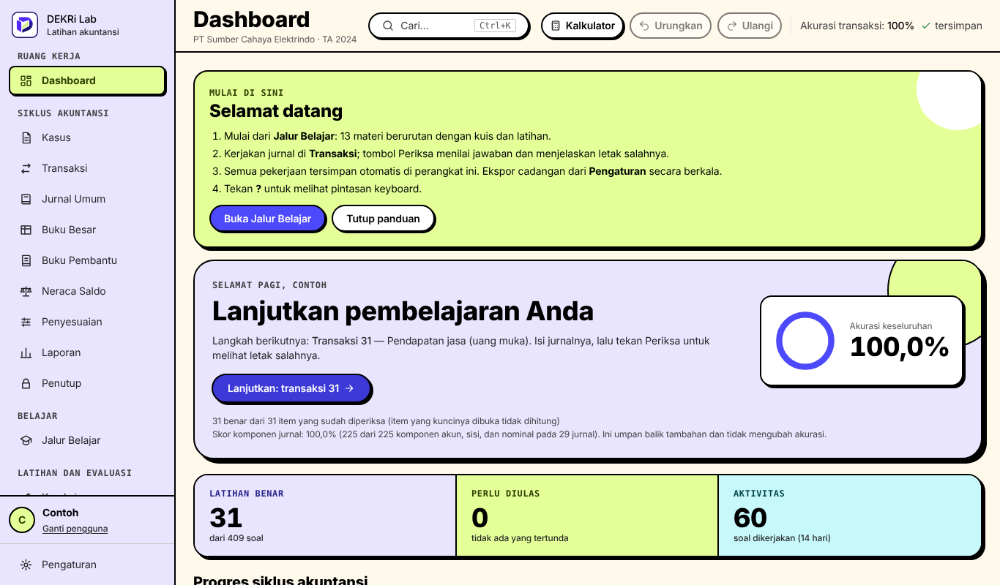 **Dashboard**: progres, akurasi, dan langkah berikutnya | 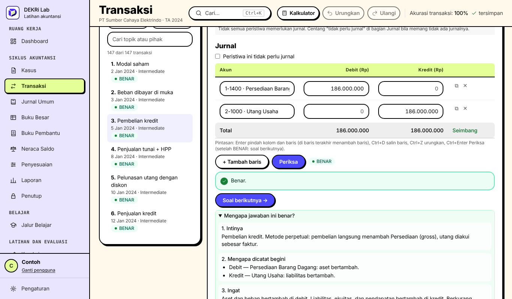 **Transaksi**: isi jurnal, tekan Periksa, dan lihat penjelasannya |
| 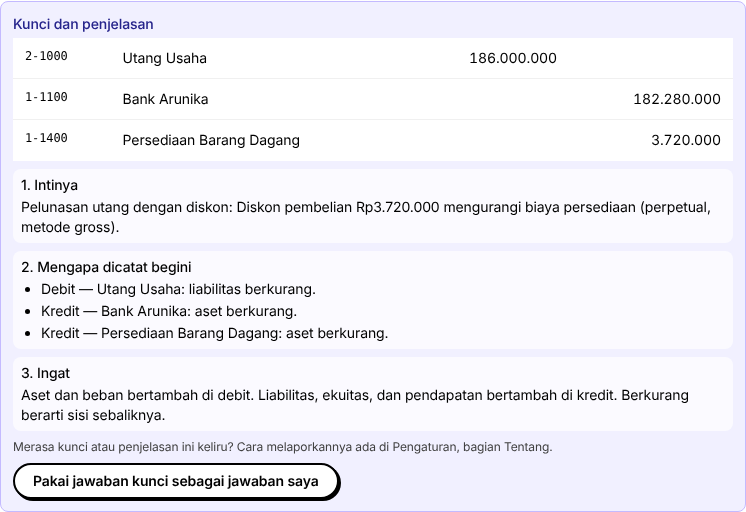 **Kunci dan penjelasan** bertahap, bukan hanya jawaban       | 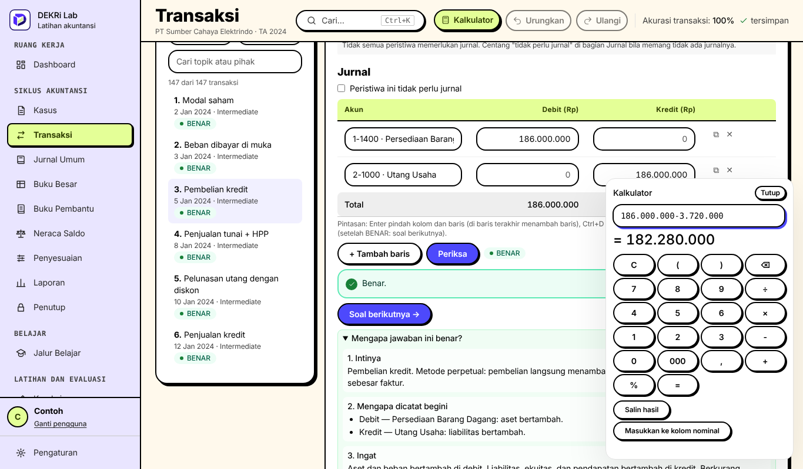 **Kalkulator** yang bisa digeser, dengan titik ribuan otomatis              |
| 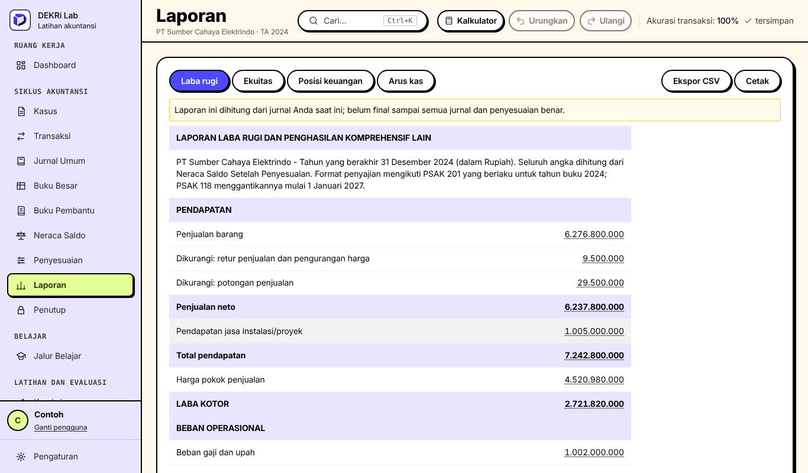 **Laporan keuangan** dihitung dari jurnal Anda                                   | 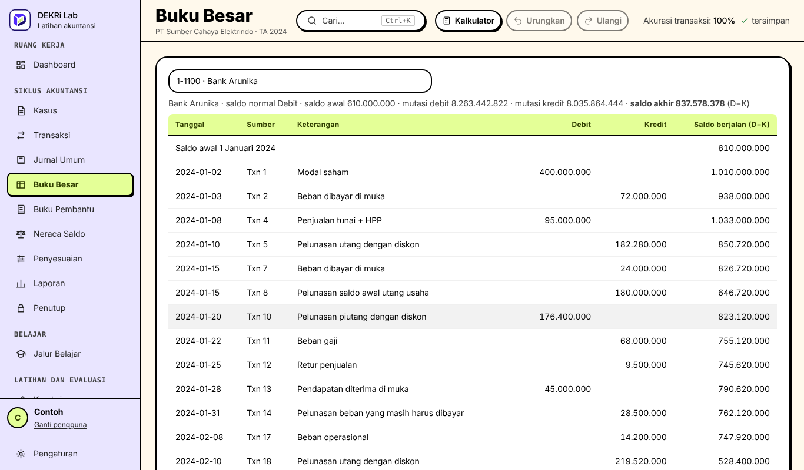 **Buku besar** per akun dengan saldo berjalan                                        |
| 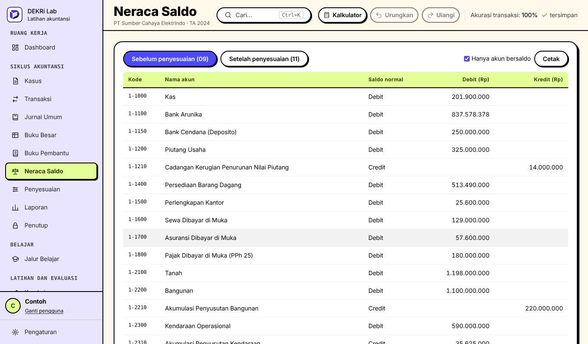 **Neraca saldo** sebelum dan sesudah penyesuaian                                 | 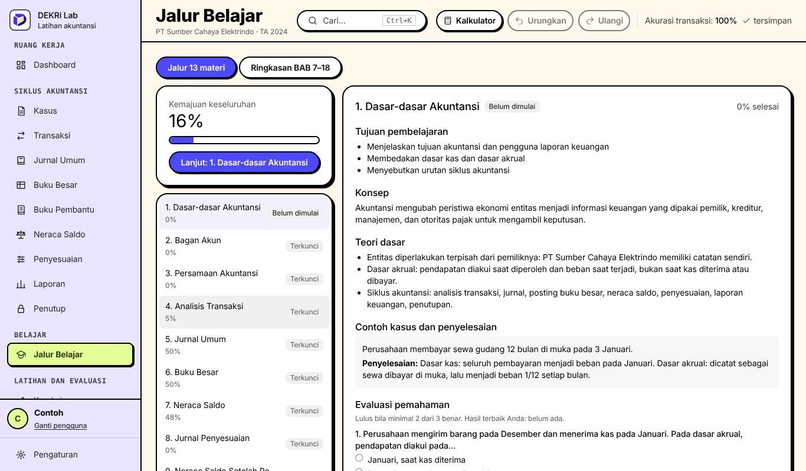 **Jalur belajar**: 13 materi dengan kuis                                       |
| 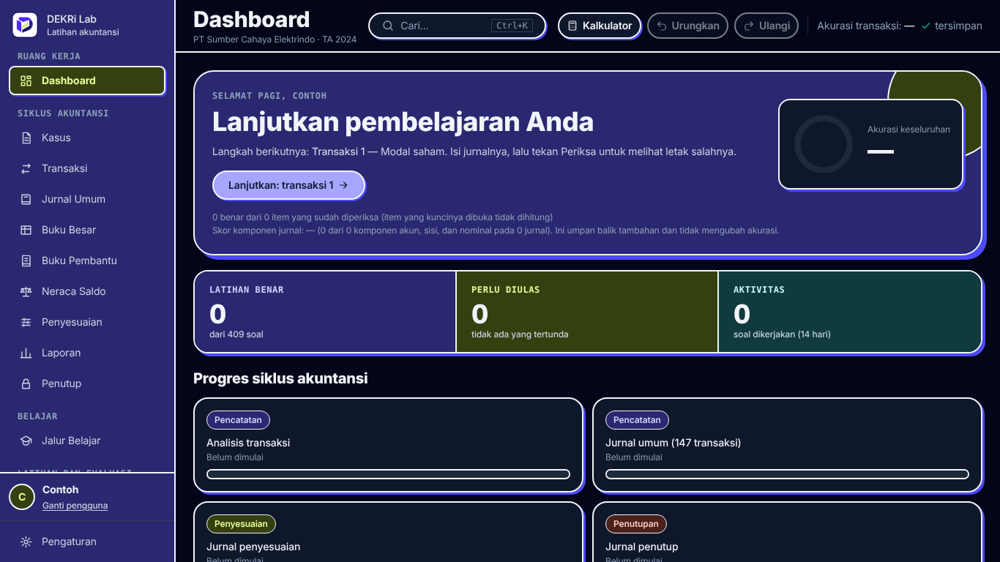 **Tema gelap**                                                                   | 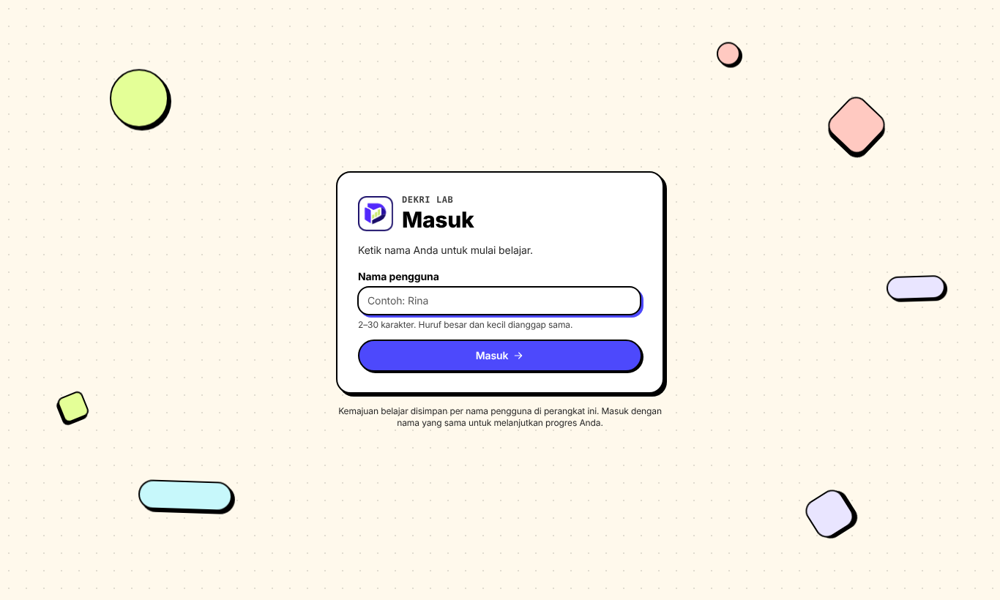 **Masuk dengan nama** (tanpa kata sandi)                                          |

## Progres dan cadangan

- Versi yang dipasang menyimpan cadangan otomatis di folder **Dokumen > Latihan Siklus Akuntansi > Cadangan**. Nama folder itu sengaja tidak diubah supaya progres lama tetap terbaca.
- Anda juga bisa mengekspor cadangan sendiri lewat **Pengaturan > Cadangan**.
- Cadangan tidak dienkripsi. Jangan membagikannya ke orang lain kalau tidak ingin jawaban Anda terlihat.

## Penting dibaca

- Ini alat belajar mandiri, **bukan** pengganti standar akuntansi resmi, dan **bukan** nasihat akuntansi, pajak, atau hukum.
- Proyek ini **tidak memiliki afiliasi apa pun** dengan lembaga atau pihak mana pun.
- Kunci jawaban ada di dalam aplikasi, jadi aplikasi ini tidak cocok dipakai sebagai alat ujian yang anti-curang.
- Materi dan soal disusun dengan bantuan AI (Claude) berlandaskan standar akuntansi, lalu disunting pemilik. Logo dibuat dengan ChatGPT. Penjelasan lengkap: [asal konten](docs/CONTENT_SOURCES.md) dan [asal logo](docs/ASSET_ATTRIBUTION.md).
- Soal disusun agar sesuai dengan standar akuntansi (PSAK), tetapi masih mungkin ada kesalahan. Kalau Anda menemukannya, laporkan lewat [Issues di GitHub](../../issues/new?template=soal_salah.yml) atau lewat Pengaturan > Tentang di aplikasi.

Dokumen lain: [Penafian](DISCLAIMER.md) · [Privasi](PRIVACY.md) · [Keamanan](SECURITY.md) · [Perubahan](CHANGELOG.md) · [Cara berkontribusi](CONTRIBUTING.md)

## Lisensi

Hanya **kode sumber** yang berlisensi [MIT](LICENSE). Logo, kasus, kunci jawaban, dan materi belajar tidak otomatis termasuk lisensi itu (lihat [cakupan lisensi](docs/LICENSING.md)). Font Inter memakai lisensi SIL OFL 1.1, dan pustaka pihak ketiga memakai lisensinya masing-masing ([daftar](THIRD_PARTY_NOTICES.md)).

## Untuk pengembang

Cara menjalankan dari kode sumber, membangun installer, menjalankan tes, dan rincian fitur ada di [docs/DEVELOPMENT.md](docs/DEVELOPMENT.md) dan [docs/BUILD.md](docs/BUILD.md).
